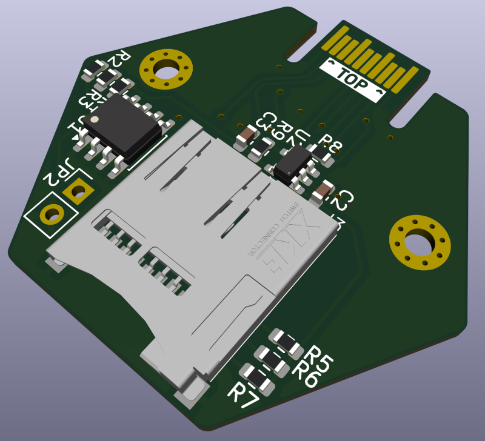

# SD Hexpansion

A Hexpansion for the [EMFCamp Tildagon badge](https://tildagon.badge.emfcamp.org/) which adds a MicroSD card socket in SPI mode.  The Hexpansion has an 8kB EEPROM and has a load switch for the SD card (there are a bunch of reasons SD cards can get "stuck" and are only recoverable by power cycling).

## Design files

The design for the single part is in `sdhexpansion.kicad_pro`.  Once this was complete and passing ERC a panel was created using [KiKit](https://github.com/yaqwsx/KiKit), the configuration for this is in sdhexpansion-panel.json.  The resulting KiCad board file is the `sdhexpansion-panel.kicad_pcb`.  The manufacturing files for JLCPCB were generated from the panel file using KiKit on the cli:

    kikit fab jlcpcb --no-drc --assembly --schematic sdhexpansion.kicad_sch sdhexpansion-panel.kicad_pcb sdhexpansion_v1

The manufacturing files are in `sdhexpansion_v1` folder.  These files are all for the 2x2 panel, so if you upload and order 5 you get 20 boards etc.

## Software

The EEPROM on the SDHexpansion can be programmed with a simple app that lets you
mount/unmount and format the storage.  Source is in the `app` directory.  To squeeze
the most out of the 8kB EEPROM on the hexpansion I've been compiling to
a `*.mpy` file, I've done this already but if you want to modify it you'll need to
do this step.  You need the [mpy-cross](https://pypi.org/project/mpy-cross/) tool
then you can simply run

    mpy-cross app.py

To setup a blank SD Hexpansion you need to plug it in to your badge and connect to the badge using [mpremote](https://docs.micropython.org/en/latest/reference/mpremote.html).  The Tildagon on-board Hexpansion manager will be able to do
this for you soon, but for development reasons you'll still need to follow these steps.

On the host change into the `app` directory of a checkout of this repository and run:

    mpremote mount .

This will connect to the running micropython system on your badge, hit `Ctrl-C` to
interrupt the normal OS and get a Python prompt.  Make sure the SDHexpansion is in port 2 (the right hand side) and short out the write-protect pins to allow the EEPROM to be overwritten (I normally use a pair of tweezers, but a jumper wire or even a bent paperclip will probably do).  Then on the mpremote terminal type:

    import prepare_eeprom

And that's it, the code runs on import and should have set up the EEPROM and copied the app.  Reboop the badge and you should get a new app offering to let you "Mount", "Remove" or "Format" the SD card.
